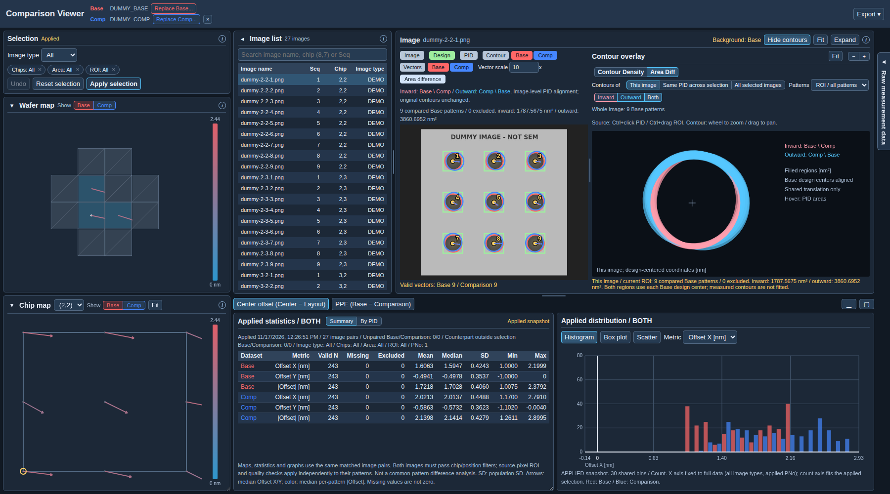
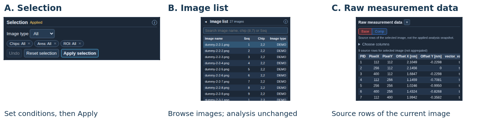
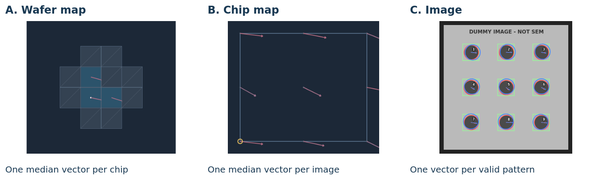
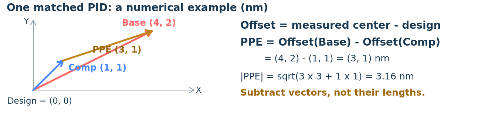
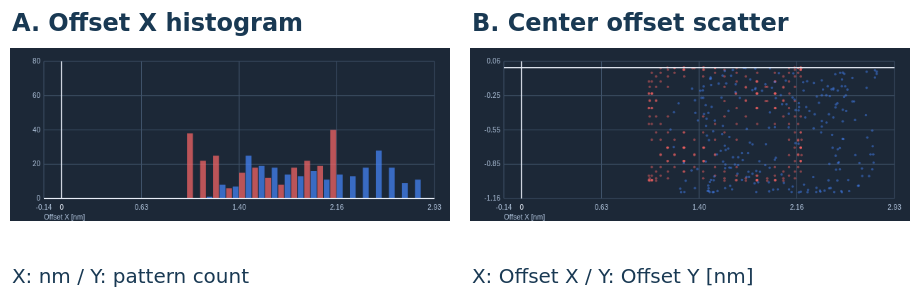
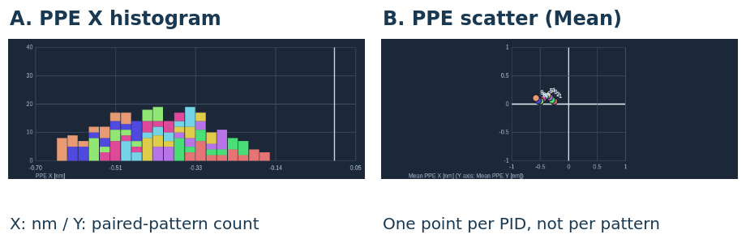
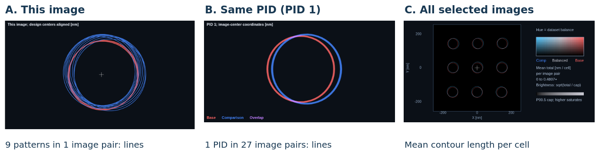
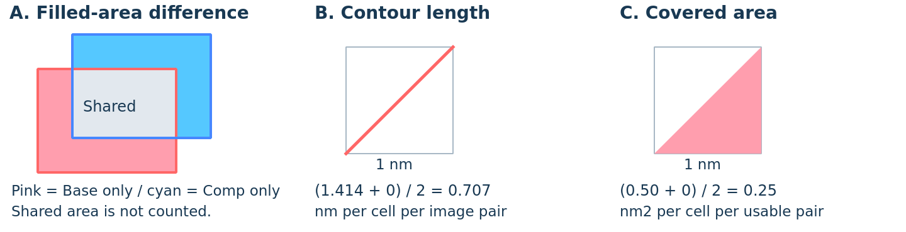
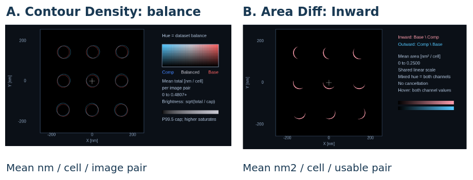

# Comparison Viewer User Guide

View one dataset (**Base**) or compare two (**Base / Comp**).
Explore center offsets, PPE, contours, and filled-area differences.
All illustrations use **dummy images and fictional measurement data**, not actual SEM images.

## 1. Requirements

- Windows 10 / 11 (x64). Python and Qt are bundled; no installation is needed.
- One or two `.sqlite` files from the matching **comparison_viewer_data_builder** (SQLite v4).
  Rebuild older or incompatible files with the current Builder.
- Files are named `<MSR name>.sqlite`, or `dataset.sqlite` when the MSR name is unavailable.
  Keep results with the same name in separate folders, or rename them without changing `.sqlite`.

## 2. Open Data

1. Extract **all files** from the Viewer ZIP.
2. Double-click **start-viewer.cmd**. Keep the console window open.
3. Click **Open Base...**. The Viewer calculates the initial maps and statistics.
4. Optional: click **Open Comp...** to compare another dataset.

| Control / mode | What it does |
|---|---|
| Replace Base... / Replace Comp... | Change one file; keep the other |
| × beside Comp | Close Comp and return to Base only |
| Base only | Analyze all selected Base images; Comp controls, PPE, and Area Diff are disabled |
| Base + Comp | Analyze matched image pairs only; N may be smaller than in Base only |

Cancelling a file dialog or opening an unsupported file leaves the current view unchanged.
Files are opened read-only. You may use the same file on both sides for self-comparison.

## 3. Screen Layout

*Figure 1. Main window. Dummy images and fictional data throughout.*

| Where | Panel | Use |
|---|---|---|
| Left | Selection / Wafer map / Chip map | Choose the analysis region; inspect offset arrows |
| Beside Image | Image list | Search and choose an image |
| Center | Image / Contour overlay | Inspect images, contours, vectors, and area differences |
| Bottom | Center offset / PPE | Read statistics and graphs |
| Right edge | Raw measurement data | Open original rows; switch Base / Comp and choose columns |

Drag panel dividers to resize; double-click to reset. **◂ / ▸** collapses the image list,
**▼** collapses a map, and **▁ / ▢** minimizes/maximizes the results.
Hover over **(i)** for panel help.

## 4. Select, Apply, Export

1. **Select** an image type and region using the controls below.
2. Click **Apply selection** to update maps, statistics, and graphs together.
3. Review **Summary / By PID**, then choose Histogram / Box plot / Scatter.
4. Open **Export ▾** to save CSV.

| Selection | How to set it |
|---|---|
| Image type / PNo | Use the selectors (PNo appears only when needed) |
| Chips | Click the Wafer map; Ctrl+click adds/removes chips. None selected means all measured chips |
| Chip area | Ctrl+drag on the Chip map; applies to every selected chip |
| Image ROI | Ctrl+drag on Image; applies across the selected images |
| Clear / restore | × on a condition clears it; Reset selection clears spatial conditions; Undo restores the previous selection |

*Figure 2. A changes analysis conditions; B browses images; C shows individual source rows.*
The raw-data drawer follows the current image, not the applied population. Its Base / Comp
tabs are independent of the map switch.

**Pending changes / Not applied** means results still show the last applied selection.
Statistics and PPE export stay disabled until you apply. Browsing images, panning, zooming,
and changing the focus chip do **not** change the analysis selection.

| Export menu | CSV content |
|---|---|
| Center offset statistics / statistics by PID | Summary table / per-PID table |
| PPE statistics by PID / values per pattern | PPE table / individual pattern pairs |
| Raw measurement data - Base / Comp | Current image rows for the chosen dataset and columns |

CSV uses **Base / Comparison** as dataset names. PPE exports require both files.

## 5. View Controls

| Action | Effect |
|---|---|
| Drag / mouse wheel | Pan / zoom |
| Ctrl+drag | Select a chip area or image ROI |
| Fit | Reset that view's pan and zoom; keep the selection |
| Click a Chip-map image position | Show the image; repeated clicks cycle through image types |
| Image-list row / Up or Down | Change the displayed image |
| Image-list search | Filter by name, chip (for example `8,7`), or exact Seq; statistics are unchanged |
| Expand | Open a larger image window; Esc closes it |
| Show Base / Comp on either map | Switch both maps and the Image background; does not filter statistics or overlay layers |
| Image / Design / PID | Toggle the background, design, or labels |
| Contour / Vectors | Toggle both available datasets together; Base / Comp chips also work independently |
| Vector scale | Magnify Image arrows only; statistics are unchanged |
| Area difference | Show filled inward/outward regions on the whole current image (see 7.3) |
| Show contours / Hide contours | Open/close the right-hand Contour overlay panel (see 7.2) |

**Filled = ON; outlined = OFF; dashed group button = partly ON.**
Click a dashed Contour/Vectors button to turn both ON. Base is red, Comp blue, and Design green.
If the Comp background cannot be aligned, Base stays visible and the heading explains why.
Expand follows the current layers and contour settings, with independent pan/zoom and the same ROI.

### What the Maps and Image Show

*Figure 3. The same center-offset quantity at three levels, not three different error definitions.*

| Area | One arrow represents | Color / position |
|---|---|---|
| Wafer map | Median Offset X and median Offset Y of valid patterns in that chip | Chip position; color = median per-pattern offset magnitude [nm] |
| Chip map | Median Offset X and median Offset Y in that image | Image's chip-relative position; same magnitude color scale |
| Image | One valid pattern's Offset X / Y | Pattern position; Base / Comp layers can both be shown |

Map colors do **not** show PPE or Area Diff. Arrow magnification is for visibility;
read nm values from the hover text/color bar. A median-magnitude color need not equal
the length of the vector made from the two component medians.
Map and Image arrows use different display magnifications; do not compare their on-screen lengths.

## 6. Read Statistics and PPE

**Center offset** asks "Where is the measured center relative to its design?"
**PPE** asks "How different are the two design-relative offsets for the same PID?"
Neither is a contour-size or area measurement.

*Figure 4. A single matched PID in design-relative nm coordinates. The orange arrow is Base minus Comp.*

### 6.1 Center Offset: Individual Measurements

*Figure 5. A counts measurements in Offset X bins; each point in B is one valid pattern.*

| Display | Value visualized |
|---|---|
| Histogram | X = selected metric [nm]; Y = number of valid patterns in each bin. Red = Base, blue = Comp |
| Box plot | One box per dataset: Q1 / median / Q3, 1.5 IQR whiskers, and outliers. Horizontal axis = selected metric [nm] |
| Scatter | One point per valid pattern: X = Offset X, Y = Offset Y [nm]. Red / blue identify datasets, not PIDs |

**Metric** selects Offset X, Offset Y, or `|Offset| = sqrt(X² + Y²)` for Histogram / Box plot.
Scatter always shows X versus Y; it is **not** a plot of PID averages.
**Summary / By PID** changes the table grouping, not the chart population.

| Table item | Meaning |
|---|---|
| Summary / By PID | Overall statistics / one row per dataset and unique PID |
| N / Missing / Excluded | Valid values / unavailable values / values rejected by quality checks |
| Mean / Median / SD | Average / middle value / population standard deviation of that metric [nm] |

Base and Comp are summarized independently within the matched image cohort.
Their valid pattern counts may differ; these charts are not paired-pattern differences.

### 6.2 PPE: Paired Differences

For each valid same-PID pair, first calculate
`PPE X = Base Offset X - Comp Offset X`, likewise for Y;
`|PPE| = sqrt(PPE X² + PPE Y²)`. Then summarize these paired values.
**Do not subtract the two offset lengths or the two dataset summary rows.**

*Figure 6. A stacks paired measurements by PID; each point in B summarizes one PID.*

| Display | Value visualized |
|---|---|
| Table | All valid pairs, or one row per PID. N = valid pattern pairs; Mean / SD are calculated from each pair's X, Y, or magnitude |
| Histogram | X = selected PPE component [nm]; Y = pair count. Bars are stacked by PID; colors match the table, not Base / Comp |
| Box plot | One box per PID; X = PID, Y = selected PPE component [nm]. Box / whiskers / outliers use the same definition as Center offset |
| Scatter: Mean | One point per PID: X = mean PPE X, Y = mean PPE Y [nm]. Near the origin means little average vector difference |
| Scatter: SD | One point per PID: X = SD of PPE X, Y = SD of PPE Y [nm]. Larger values mean more variation among pairs |

**Component** selects PPE X / PPE Y / magnitude for Histogram / Box plot.
Click a PID row or scatter point to focus it; **All** clears the focus.
A small mean does not guarantee small variation: check SD as well.

**Comparison rules**

- Images must match by chip, PNo, Seq, and image type. Unmatched images are excluded.
- PPE requires a unique, non-empty PID and valid measurements on **both** sides.
  PPE uses the applied selection; its ROI is tested at the Base pattern position.
- **N = 0 / — means no valid data**, not zero offset.
- Blue Wafer-map chips are measured; hatching means unmeasured.
  A **synthetic chip coordinates** warning marks test data: do not use it for process analysis.

## 7. Contour Overlay

### 7.1 Choose a Scope

Click **Show contours**, choose **Contour Density** or **Area Diff**, then select a scope.

| Scope | Patterns / coordinate frame |
|---|---|
| This image | Current image's ROI patterns, or Clicked PIDs; each pattern is centered on its design |
| Same PID across selection | One unique common PID across the applied image pairs; common image-center frame |
| All selected images | Applied chip/area/image-type/ROI selection; each image's design-layout center is the origin |

These origins preserve offsets from design; they do **not** fit measured contours to each other.
ROI chooses patterns by their stored Pixel positions; it does not cut out pieces of their contours.

**This image:** click a pattern; Ctrl+click adds/removes PIDs. **Clicked PIDs** replaces this
panel's ROI; **Clear PIDs** empties it. Ctrl+drag returns to ROI.
**Same PID:** click a pattern or use the PID selector. A yellow center dot marks selected patterns.

Pan/zoom and **Fit** work independently in the contour panel. Loading shows elapsed time;
cached results are reused. An error shows **Retry**.

### 7.2 Contour Density

*Figure 7. A: many patterns in one image pair. B: one PID across many image pairs.
C: all selected contours accumulated on a spatial grid. These are different populations and origins.*

| Scope / display | How to read it |
|---|---|
| This image / Same PID | Contour lines: Base red, Comp blue; purple marks coincident strokes in Both |
| All selected: Focus | Emphasize Base or Comp; the other is a faint guide |
| All selected: Base vs Comparison | Red = more Base density, cyan = more Comp, gray = similar; brighter = more total density |

All selected density is **mean contour length per cell per image pair** (per image in Base only),
on a 1024 × 1024 grid. The legend shows units and range; values above the cap saturate (`+`).
The horizontal/vertical coordinates are **X / Y position in nm**, not offset components.
In Focus, a brighter cell means more mean contour length passing through that cell.
In Base vs Comparison, hue shows the dataset balance and brightness shows combined length.
Density differences may reflect movement, shape, or population variation—not a per-PID displacement.
This image / Same PID are **line overlays**, not calibrated density heatmaps.
Purple line overlap is not an area percentage, and density is not filled area or occurrence probability.

**SEM / Design** in All selected show the **current image**, not the population average.
They follow the displayed Base/Comp dataset; **SEM opacity** changes only that reference image.

### 7.3 Area Diff

Requires Base and Comp. Patterns are paired by unique PID within each image pair.

*Figure 8. A excludes shared area. B measures line length; C measures filled coverage.
Toy cells are 1 nm × 1 nm with two image pairs (both usable for Area Diff); the second contributes
zero in this cell. Actual grid-cell size depends on the view extent.*

| Display / channel | Value visualized |
|---|---|
| Light pink: Inward | Base outside Comp (`Base \ Comp`) |
| Cyan: Outward | Comp outside Base (`Comp \ Base`) |
| Image: Area difference | Whole-image filled regions, independent of ROI or clicked PIDs; hover for each PID's nm² |
| This image | Filled differences for the ROI or clicked PIDs, aligned on each Base design center |
| Same PID / All selected | Heatmap: **mean nm² per cell per usable image pair**, on a 1024 × 1024 grid |

- The heatmap's X / Y axes are **spatial positions [nm]**. A brighter pink/cyan cell has more
  mean inward/outward **area**, not a larger offset in nm. Same PID uses the image-center frame;
  All selected uses the Base design-layout center.
- **Inward / Outward / Both** changes visibility only. Both uses a shared linear scale;
  mixed colors mean both channels occurred, not cancellation. Hover reads both values.
- A usable pair has at least one successful pattern comparison. Exclusion reasons, usable pairs,
  and compared patterns are reported. Comp-only PIDs are not candidates.
- Comp uses Image's mean PID-position translation; contours are **not individually fitted**.
  Displacement and shape changes both contribute. Equal Base/Comp pixel calibration is required.
- Invalid/missing geometry or ambiguous PIDs are excluded; center-offset quality flags do not filter geometry.
  **Zero area is valid data.** All selected SEM/Design references always use the current **Base** image.
- Large selections can take time and use extra memory. Closing during calculation may wait for cleanup.
  Area Diff does not change the Wafer/Chip maps and has no CSV export.

*Figure 9. The same selection, two quantities. A: contour length, with Base/Comp balance as hue.
B: inward covered area as pink brightness. Use each legend's units and hover readout;
the colors are not interchangeable.*

## 8. Troubleshooting

| Symptom | Action |
|---|---|
| Viewer does not start | Send the console error to the development team |
| Cannot open a dataset | Use a compatible Builder SQLite v4 file; rebuild older files |
| Results do not update | Click Apply selection if Pending changes is shown |
| — / no common images or PIDs | Check file pairing, selection, and valid measurements |
| Comp / PPE / Area Diff disabled | Open Base, then Comp |
| Bin width too small | Increase Bin width or click Auto (maximum 400 bins) |
| Contour calculation failed | Read the error; fix the input/selection and click Retry |
| Screen is cut off | Enlarge the window (about 1270 px wide), scroll horizontally, or collapse panels |
